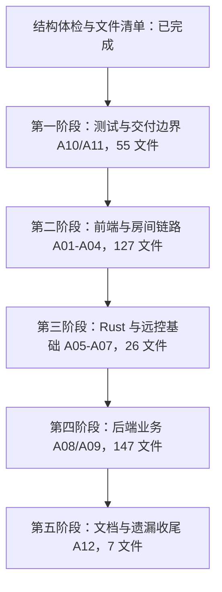

# 仓库审查计划与进度

更新于 2026-10-12。以单人可维护、行为清楚、一条正式链路为目标；编码规范见 AGENTS.md，代码导航见 CODE_GUIDE.md，产品待办仍在本地 docs/TODO.md。

## 本窗口的职责

- 本窗口负责计划、解释实际操作、核对产品规则、代码审查、进度和小修正；大量机械修改交给实施窗口。
- 实施前先整理与本模块相关的代码，保持行为；公开入口、状态来源、资源归属、成功、失败、取消、重试、权限、平台差异和清理规则。
- 有歧义的产品规则先与用户确认，再写实施提示词。实施窗口的完成说明不是验收证据，返回后检查实际 diff 与测试。
- 每个修复闭环独立提交，使用中文说明，不夹带其他未提交修改。无修改的审查不制造空提交。
- 不同时大改多个模块，不按行数拆文件，不为了减少重复强行合并不同媒体的生命周期，不擅自新增功能。

## 2026-10-12 结构体检

这是结构、调用边界及规划体检，不是全部代码的逐行验收。

- 建立清单前有 360 个 Git 跟踪文件：包括前端同目录单测 38 个、Electron 单测 8 个、浏览器/桌面集成用例 16 个、Java 测试目录文件 30 个。Rust 还有内嵌单测，不以文件数量代表覆盖度。
- 前端 `*.test.ts` 与生产模块相邻，但未发现生产模块导入它们；Rust 内嵌单测由 `#[cfg(test)]` 隔离。相邻存放不等于进入正式程序，不批量搬迁。
- `src/rtc/screenShareEncodingBenchmark.test.ts` 引用 `tests/desktop/fixtures/encodingCost.ts`：这是测试到测试的依赖，不是正式链路泄漏；位置可在测试边界整理时调整。
- 前端 tsconfig 同时包含 src 和 tests，生产构建会被测试类型错误阻断。属于检查入口耦合，需明确保留测试类型检查再考虑分离，不能直接跳过测试。
- Electron 打包显式列出运行文件；检查已有 2026-10-11 安装产物的 app.asar，未发现本项目 tests、src、Electron 单测或 smoke 文件，也未发现 Vitest、Playwright、TypeScript、electron-builder 包。该结果仅代表该产物，不代表下一次打包已经验收。
- Java 测试位于 src/test，测试依赖使用 test scope；部署 Docker 上下文仅包含 jar 和 Dockerfile。正式 jar 的最终内容仍待交付批次检查。
- shared-texture-smoke 与 Rust 示例仍被纹理桥接回归调用，视频诊断探针仍被设置页面使用，均保留。
- 根 compose.yaml 是本机开发依赖入口，deploy/server 是部署包入口；electron/server-config.json 仍被开发客户端读取，不按名字删除。
- App、RTC 编排、Electron 主进程和 Rust 运行时仍较集中；存在独立职责，不据此认定业务分支全部冗余。
- 固定不可用的 systemAudioCapture/processAudioCapture 能力字段是清理候选，需在协议批次检查 Rust、Electron、类型及测试后同步删除。
- 已删除本地旧 docs/PLAN.md 和 QQ认证链路审阅.md：前者仍描述开放注册和 Chromium 正式采集，后者描述被替代的强制 QQ 登录链路。个人 LEARNING.md 保留历史标记并修复旧链接。这些本地文档受 Git 忽略。
- TODO 删除已实现的选择器实施描述，保留实机验收；第三层编码改为按真实负载再决定，过时依赖风险计数不继续沿用。

## 文件覆盖与完成标准

逐文件台账见 REVIEW_FILES.csv。每个路径只归属一个主要模块；跨模块文件在最终收尾时核对全部职责。源码、测试、配置、脚本、迁移、资源和文档均在范围内。第三方依赖、构建产物、运行数据、凭据、日志和个人笔记不纳入逐行代码清单。

状态使用：待审、局部审查、待用户确认、待实施、待复审、完成。局部修复不能把整个文件标为完成。证据写入台账；没有发现问题也要记录阅读范围。实机未验收单独记录，不混同逻辑审查完成。

每批结束重新比较 `git ls-files` 与清单，补入新增文件、移除已删除路径；新提交导致的变化标为待复审。文件完成需要：已读全部内容、核对调用与相关测试、无未决逻辑问题、产品规则已确认；资源与性能的实机限制仍需明确。

## 模块顺序

| 编号 | 范围 | 本轮进度 / 下一动作 |
|---|---|---|
| A10 | 测试工具、替身、性能测量与隔离 | 已做结构核对；优先检查测试类型与生产构建、打包边界 |
| A01 | 共享选择界面、来源模型及相关测试 | 181e284 完成一个修复闭环；真实预览与性能待测，文件全审仍需补齐 |
| A02 | 主界面、设置、资料、群聊展示与样式 | 待审；按用户操作解释，先整理 App 的独立职责 |
| A03 | 入房离房、音视频发布、观看和偏好 | 待审；重点状态唯一性、跨房间迟到结果和多资源清理 |
| A04 | Electron 窗口、代理、会话、唤起、更新与活动 | 待审；检查可信调用、凭据和退出归属 |
| A05 | Rust 协议、来源、视频与纹理桥接 | 待审；复核正式 feature、句柄、停止和诊断计数 |
| A06 | Rust 麦克风、处理和共享声音 | 待审；检查处理链、队列、设备变化及资源回收 |
| A07 | 远控授权、输入与释放 | 待审；仅审现有能力，不实现私密远控、切屏或新语音功能 |
| A08 | 后端账号、激活、邀请、恢复与资料 | 待审；重点一次性链接、事务、认证和用户操作边界 |
| A09 | 后端群组、聊天、文件、状态、RTC 与公共能力 | 待审；核对 Mapper、迁移、异常与接口说明 |
| A11 | 构建、依赖、安装、部署和配置 | 待审；检查实际产物、版本一致性和配置用途 |
| A12 | 文档与覆盖收尾 | 本轮清理旧规划；最终逐条核对文件清单和文档陈述 |

具体模块可按用户测试结果调整，但不能因此把未读文件标为完成。共享选择、音频、房间等模块跨平台，台账归属不限制沿链路读取其他模块。

## 总体安排与当前进度

清单共 362 项：17 项局部审查、345 项待审，尚未标记任何文件为全量完成。已完成结构体检、旧桌面链路清理和选择器优化两个修复闭环；这不代表全部分支或实机能力已验收。

- 第一阶段先分开生产/测试类型检查，再核对测试工具与真实打包入口。
- 第二阶段按共享选择 → 设置与主界面 → 入房离房 → 麦克风/共享发布 → 观看/隐藏恢复 → Electron 边界推进。
- 第三阶段按协议与来源 → 视频纹理 → 麦克风处理 → 共享声音 → 输入授权/释放推进。
- 第四阶段按邀请激活恢复 → 资料与会话 → 群聊和文件 → 状态与 RTC 授权推进。
- 第五阶段重新比对全部跟踪路径，补审跨模块文件剩余职责，核对文档与真实验收待办。

阶段只是组织顺序，每个阶段仍按小闭环提交。测试通过不等于产品规则已确认，局部修复不等于整文件已审完，合成测试不等于实机验收。耗时按首批实际工作量评估，不预设固定完成日期。

## 参考技术的实际采用

- 已直接采用：LiveKit SDK 负责房间、发布和订阅；Sonora 0.2.0 与 sonora-common-audio 负责麦克风处理和重采样。
- 本项目自行接入：Windows WGC/D3D11、WASAPI、共享纹理、命名管道和 SendInput。使用相同系统 API 不代表移植了其他项目完整实现。
- Rushtalk：当前代码与依赖未发现直接集成证据，仅作为类似音频/LiveKit 架构的参考，不能把架构接近称作成熟度证明。[上游项目](https://github.com/Pedrom2002/rushtalk)
- RustDesk、Sunshine/Moonlight：当前代码与依赖未发现直接集成证据。后续对照具体输入、释放与帧调度问题，不引入第二套房间、传输或采集系统。[RustDesk](https://github.com/rustdesk/rustdesk)、[Sunshine](https://github.com/LizardByte/Sunshine)
- 后续源码复用记录来源、版本、适配范围及许可文本，并验证本项目里的行为；参考过项目不等于技术已完整迁入。

## 每批向用户解释的内容

1. 从哪一个按钮或实际操作进入，用户看到什么。
2. 输入来自哪里，如何校验，哪些是真实状态、哪些只是界面选择。
3. 请求和资源的创建、更新、停止由谁负责，数据实际经过哪些文件。
4. 正常成功、取消、超时、重复操作、切房、关闭、重连分别怎么走。
5. 浏览器/桌面、公开/私密、测试/正式的实际边界。
6. 哪些分支有明确用途，哪些确实无用，哪些只是候选；不要将安全释放当成多余代码。
7. 本轮验证、未验收限制，以及需要用户确认的产品规则。

## 提示词交付

具体实施提示词直接在聊天中给出，仓库不保存一次性提示词副本；长期规范、模块范围和进度分别由 AGENTS.md、本文与 REVIEW_FILES.csv 维护。

## 当前工作区边界

建立本计划时已有 FRONTEND_GUIDE.md、apps/web/src/AuthRoot.vue、apps/web/tests/desktop/auth.spec.ts 未提交修改。仓库体检提交不纳入它们；这些文件仍在后续审查范围内。
